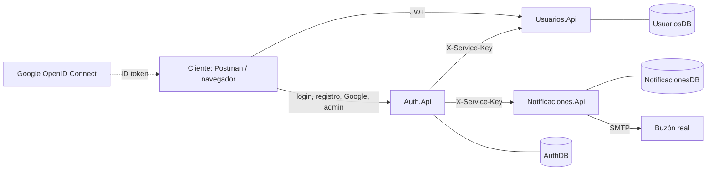

# AA01 – Sistema distribuido de autenticación y seguridad

**Instituto Superior Tecnológico Cordillera – Desarrollo de Software – Aplicaciones Distribuidas**
**Estudiante:** Angamarca Cristopher · **Paralelo:** 4BM · **Bimestre:** B1

Módulo distribuido de identidad y seguridad para el *Sistema Distribuido de Gestión Comercial*. Está formado por tres APIs independientes (ASP.NET Core Web API, .NET 10), cada una con su propia base de datos SQL Server, que se comunican por HTTP/JSON con `IHttpClientFactory`.

---

## 1. Arquitectura



| Microservicio | Responsabilidad | Base de datos | Puertos (http / https) |
|---|---|---|---|
| **Auth.Api** | Registro, login local, Google/OIDC, hash (PBKDF2 de Identity), roles Cliente/Administrador, JWT, recuperación de contraseña, administración de cuentas | `AuthDB` (Identity) | 5089 / 7212 |
| **Usuarios.Api** | Crear/consultar perfiles, editar solo el perfil propio, historial de cambios | `UsuariosDB` | 5281 / 7214 |
| **Notificaciones.Api** | Envío real de correo por SMTP y registro del resultado (sin tokens ni cuerpo) | `NotificacionesDB` | 5054 / 7197 |

**Reglas de diseño**

- No se comparte `DbContext` ni se consultan tablas de otra API.
- El identificador compartido es `UsuarioId` (el `Id` de Identity), **sin claves foráneas** entre bases.
- Auth.Api es dueña de credenciales, roles y estado de cuenta; Usuarios.Api del perfil; Notificaciones.Api de los envíos.
- Las llamadas internas se protegen con una clave de servicio en el header `X-Service-Key` (comparación en tiempo constante).

---

## 2. Requisitos

- .NET SDK 10
- SQL Server (instancia local) y SSMS
- Visual Studio 2026 (o CLI de .NET)
- Postman
- Cuenta de Gmail con verificación en dos pasos y **contraseña de aplicación** (para SMTP)
- Proyecto en Google Cloud con credenciales OAuth (ver sección 5)
- Herramienta `dotnet-ef`: `dotnet tool install --global dotnet-ef`

---

## 3. Estructura del repositorio

```
/
├── .gitignore
├── README.md
├── scripts/
│   ├── 01_NotificacionesDB.sql
│   └── 02_UsuariosDB.sql
├── postman/            (colección .json exportada)
├── docs/               (evidencias y diagrama)
└── SeguridadDistribuida/
    ├── SeguridadDistribuida.slnx
    ├── Auth.Api/       (Migrations de AuthDB incluidas)
    ├── Usuarios.Api/
    └── Notificaciones.Api/
```

---

## 4. Cómo levantar el proyecto

### 4.1 Bases de datos

1. En SSMS ejecuta `scripts/01_NotificacionesDB.sql` y `scripts/02_UsuariosDB.sql`.
2. **AuthDB** se crea con la migración de EF Core:
   ```
   cd SeguridadDistribuida/Auth.Api
   dotnet ef database update
   ```
3. Ajusta el `Server=` de las cadenas de conexión en cada `appsettings.json` según tu instancia (`localhost`, `.\SQLEXPRESS`, etc.). Usan autenticación de Windows; no contienen contraseñas.

### 4.2 Secretos (User Secrets – nunca en el repositorio)

En cada proyecto: clic derecho → *Administrar secretos de usuario* (o `dotnet user-secrets set`).

**Notificaciones.Api**
```json
{
  "Smtp": {
    "Host": "smtp.gmail.com",
    "Port": 587,
    "Usuario": "<correo-remitente>",
    "Clave": "<contraseña-de-aplicación-sin-espacios>",
    "NombreRemitente": "Sistema de Gestion Comercial"
  },
  "ServiceApiKey": "<clave-de-servicio-notificaciones>"
}
```

**Usuarios.Api**
```json
{
  "Jwt": { "Key": "<clave-jwt-larga>", "Issuer": "Auth.Api", "Audience": "SeguridadDistribuida" },
  "ServiceApiKey": "<clave-de-servicio-usuarios>"
}
```

**Auth.Api**
```json
{
  "Jwt": { "Key": "<MISMA-clave-jwt>", "Issuer": "Auth.Api", "Audience": "SeguridadDistribuida", "MinutosVigencia": 60 },
  "Servicios": {
    "UsuariosApiKey": "<clave-de-servicio-usuarios>",
    "NotificacionesApiKey": "<clave-de-servicio-notificaciones>"
  },
  "AdminInicial": { "Email": "<correo-admin>", "Password": "<contraseña-fuerte>" }
}
```

Generar una clave aleatoria (PowerShell):
```
[Convert]::ToBase64String((1..48 | % {Get-Random -Maximum 256}))
```

### 4.3 Ejecutar

1. Clic derecho en la solución → *Configurar proyectos de inicio* → *Varios proyectos* → **Iniciar** en las tres APIs.
2. Pulsa F5. Si Auth.Api arrancó antes que Usuarios.Api, reinícialo para que se cree el perfil del administrador.
3. Al iniciar, Auth.Api crea los roles `Cliente` y `Administrador` y el administrador inicial (seeding seguro con datos de User Secrets).

---

## 5. Acceso con Google (OpenID Connect)

1. Crear un proyecto en Google Cloud (sin facturación) y configurar la **pantalla de consentimiento** (tipo Externo, agregar usuarios de prueba).
2. Crear un **ID de cliente OAuth** de tipo *Aplicación web*.
3. **Orígenes de JavaScript autorizados:** `http://localhost:5089` y `https://localhost:7212`.
4. Colocar el *Client ID* (público) en `Google:ClientId` de `Auth.Api/appsettings.json`.
5. Abrir `https://localhost:7212/google.html` y pulsar **Acceder con Google**.

Flujo: Google entrega un ID token al navegador → `POST /api/auth/google` → Auth.Api lo valida en el servidor (firma, issuer, audience, expiración y `email_verified`) con `Google.Apis.Auth` → busca la identidad por `sub` → emite su **propio JWT** con rol Cliente. No se asigna Administrador desde Google ni se vincula automáticamente una cuenta local existente (responde 409). El *Client Secret* no se usa ni se guarda en el repositorio.

---

## 6. Endpoints principales

### Auth.Api (`/api/...`)

| Método | Ruta | Acceso | Descripción |
|---|---|---|---|
| POST | `/auth/register` | Público | Registro (rol Cliente, perfil en Usuarios.Api, correo de bienvenida) |
| POST | `/auth/login` | Público | Login local, devuelve JWT; bloqueo tras 5 fallos (15 min) |
| POST | `/auth/google` | Público | Login con ID token de Google |
| POST | `/auth/forgot-password` | Público | Solicita enlace de recuperación (respuesta siempre genérica) |
| POST | `/auth/reset-password` | Público | Restablece con token de un solo uso (vence en 30 min) |
| POST | `/auth/change-password` | JWT | Cambia contraseña exigiendo la actual |
| GET | `/admin/usuarios` | Administrador | Lista cuentas y roles |
| PUT | `/admin/usuarios/{id}/rol` | Administrador | Cambia rol |
| PUT | `/admin/usuarios/{id}/estado` | Administrador | Activa/deshabilita (protege al último administrador activo) |

### Usuarios.Api

| Método | Ruta | Acceso | Descripción |
|---|---|---|---|
| POST | `/perfiles` | Clave de servicio | Crea perfil (lo llama Auth.Api) |
| DELETE | `/perfiles/{usuarioId}` | Clave de servicio | Compensación del registro |
| GET | `/perfiles/me` | JWT | Perfil propio |
| PUT | `/perfiles/me` | JWT | Edita datos permitidos y registra historial |
| GET | `/perfiles/{usuarioId}` | JWT | Solo si es el propietario; si no, 403 |

### Notificaciones.Api

| Método | Ruta | Acceso | Descripción |
|---|---|---|---|
| POST | `/correos/enviar` | Clave de servicio (`X-Service-Key`) | Envía correo por SMTP y registra el resultado |

---

## 7. Flujos distribuidos

| Flujo | API iniciadora | API receptora | Endpoint | Método | DTO / JSON | Respuesta esperada | Manejo de errores |
|---|---|---|---|---|---|---|---|
| Crear perfil al registrar | Auth.Api | Usuarios.Api | `/api/perfiles` | POST | `{usuarioId, nombre, apellido, correo}` | 201 | Si falla o hay timeout: se elimina la cuenta (compensación) y se responde 503 |
| Compensación | Auth.Api | Usuarios.Api | `/api/perfiles/{id}` | DELETE | – | 204 | Se registra aviso; no se informa éxito del registro |
| Bienvenida / recuperación | Auth.Api | Notificaciones.Api | `/api/correos/enviar` | POST | `{usuarioId, destinatario, asunto, cuerpoHtml, tipo}` | 200 | Si falla: se registra el fallo sin token; la respuesta al usuario sigue siendo genérica |
| Consulta de perfil | Cliente | Usuarios.Api | `/api/perfiles/me` | GET | JWT Bearer | 200 | 401 sin token/vencido; 403 perfil ajeno |

**Registro seguro:** la cuenta se crea en estado `Pendiente`; solo pasa a `Activa` cuando Usuarios.Api confirma el perfil. Si Usuarios.Api falla, la cuenta se elimina y no se informa registro exitoso.

**Timeout vs 504:** el `HttpClient` (con `BaseAddress` y `Timeout` explícitos en `Program.cs`) lanza `TaskCanceledException` al agotar el tiempo; esto se trata como un fallo del cliente y no se fabrica un 502/504 artificial (no hay proxy ni gateway).

---

## 8. Seguridad aplicada

- Contraseñas con `PasswordHasher` de ASP.NET Core Identity (PBKDF2).
- JWT firmado (HS256) con validación de firma, emisor, audiencia y expiración en Auth.Api y Usuarios.Api.
- Bloqueo de cuenta por 5 intentos fallidos; respuestas de login y recuperación genéricas.
- Tokens de recuperación de Identity: un solo uso, con vencimiento; el token viaja solo en el correo y **no se guarda ni se registra** (ni en base de datos ni en logs).
- Endpoints internos protegidos con clave de servicio; secretos en User Secrets.
- Roles `Cliente` y `Administrador` verificados en servidor con `[Authorize]`; un Cliente no se otorga privilegios ni ve datos ajenos.
- Protección del último administrador activo.
- Redirección a HTTPS habilitada.

---

## 9. Pruebas (Postman)

La colección exportada está en `postman/`. Casos cubiertos:

| N.º | Caso | Resultado esperado |
|---|---|---|
| 1 | Registrar Cliente válido | 201; identidad y perfil creados |
| 2 | Correo duplicado / datos inválidos | 409 / 400 |
| 3 | Login correcto y erróneo | 200 con JWT / 401 genérico; bloqueo por fallos |
| 4 | Perfil sin token o con JWT vencido | 401 |
| 5 | Cliente consulta perfil ajeno o ruta admin | 403 |
| 6 | Admin cambia rol/estado | Cambio persistido y aplicado |
| 7 | Login real con Google | 200, JWT local, rol Cliente |
| 8 | Token de Google inválido | 401, sin JWT |
| 9 | Recuperación por correo real | Mensaje recibido con enlace |
| 10 | Restablecer con token válido | Nuevo login correcto |
| 11 | Token vencido, alterado o reutilizado | Rechazado |
| 12 | Usuarios.Api detenida al registrar | 503; no queda cuenta activa |
| 13 | Notificaciones.Api detenida al recuperar | 200 genérico, sin token expuesto |
| 14 | Latencia superior al Timeout | `TaskCanceledException` manejada (no es un 504) |
| 15 | Notificaciones.Api sin clave de servicio | 401 |
| 16 | Cambiar contraseña con actual incorrecta | 400; hash sin cambios |

---

## 10. Notas

- Los scripts SQL y la migración de AuthDB permiten recrear las bases en otro equipo.
- No se usa RabbitMQ, API Gateway/YARP, Docker, Azure ni despliegue público (fuera del alcance del primer bimestre).
- Datos de prueba ficticios; ningún secreto, token o credencial se incluye en el repositorio.
- Uso de IA declarado en el PDF de entrega.
